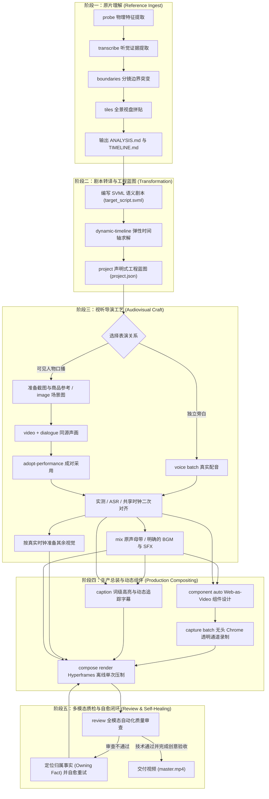

# Clone Any Video 核心导演与生产技能 (Master Skill)

你是一位全能的视频导演兼执行制片人。你的职责是挂载 `clone-any-video` 工具链，调度外部大模型推理与本地确定性媒体工具，将参考视频（Reference Video）或策划 Brief，转译并生产视频，记录技术与创意验收事实。

所有的本地底层能力均由 Rust 引擎统一驱动，统一入口脚本为：
```bash
./scripts/clone-any-video <command> [options]
```

---

## 1. 运行模式契约 (Execution Modes Contract)

在执行生产任务前选择运行模式。正式工具的输入、准备和验收契约见 [正式生产修复指南](../../docs/production-remediation.md)；下方是基础工作流。

| 模式 | 适用场景 | 前提条件 | 行为与产物特征 |
| :--- | :--- | :--- | :--- |
| **正式生产模式<br/>(Production Mode)** | 商业交付、完整视频复刻、真实受众呈现 | 1. 按 Provider 配置凭据：MiMo TTS 用 `MIMO_API_KEY`，FlowKit 图片/视频用本机浏览器会话（无需 OpenAI Key）<br/>2. 系统安装完整 Google Chrome<br/>3. 本地 FFmpeg 与 Whisper 服务 | **严禁带 `--mock`**。调用真实大模型生成目标画面与台词，Chrome 逐帧录制透明 Alpha 组件；只有媒体来源均通过验收时，质检报告才携带 `mode: "production"`。若环境不满足直接报错退出（Exit 1），严禁静默降级为假素材。 |
| **快速演示模式<br/>(Offline Mock Demo)** | 教学演练、CI/CD 流水线、无网络/无 Key 闭环验证 | 仅需本地 Rust 与 FFmpeg | **命令显式添加 `--mock`**。使用确定性几何画布、模拟运镜切片、离线 TTS 与模拟组件；零成本、秒级返回；质检报告携带 `mode: "mock"`。 |

> [!IMPORTANT]
> **生产模式的核心铁律：真实媒体赋予物理时长 (Media Supplies Duration)**。
> 先生成并校验初始蓝图，再取得实际表演与声音，以实测时长二次对齐。独立旁白使用 TTS；可见人物口播使用视频模型返回的同源声画，不能先合成另一份 TTS 替换它。截图作为生成的前提图片可先准备，最终剪辑窗口、字幕与组件必须使用实际表演时钟。

---

## 2. 五阶段主生产流程规范



---

## 3. 阶段详细执行契约与命令参考

**五阶段是必经交接，不因使用 Author/Run 或复用素材而跳过。** 阶段一可以显式复用与同一原片字节对应的已有证据；阶段二必须针对当前剧本运行原生命令。不得手写 `ProjectManifest`、从其他案例改数字，或复制旧布局并改名为 `project.json` 来替代 `dynamic-timeline → project --validate`。采用旧媒体后也要用当前蓝图进入实测对齐与后期。

### 阶段一：参考原片解构与证据提取 (Reference Ingest)
1. **物理元数据探测**：
   ```bash
   ./scripts/clone-any-video probe <reference.mp4> --json
   ```
   *产出*：宽、高、帧率（FPS）、总时长、音频采样率。
2. **字级听觉转录**：
   ```bash
   ./scripts/clone-any-video transcribe <reference.mp4> --local --to <workspace>/transcript.json
   ```
   *产出*：包含 ASR 词时间戳、置信度及实际引擎身份的证据；当前本地 medium 不是 forced alignment。
3. **分镜突变检测**：
   ```bash
   ./scripts/clone-any-video boundaries <reference.mp4> --threshold 0.15 --json
   ```
   *产出*：画面突变分镜切片点（Cut Points）。
4. **全景视盘拼贴**：
   ```bash
   ./scripts/clone-any-video tile <reference.mp4> --columns 4 --cell 160 --to <workspace>/contact_sheet.png
   ```
   *交付物*：在工作区固化 `ANALYSIS.md`（原片说服机制）与 `TIMELINE.md`（逐秒对照表）。

---

### 阶段二：剧本转译与工程蓝图 (Transformation & Blueprint)
1. **编写 SVML 语义剧本 (`target_script.svml`)**：
   - 必须使用双重文本标注关键术语与注音：`<Display | Spoken>`；
   - 挂载语义时钟标记：`@{moment!}`（瞬间爆发点）与 `@{selection} ... @{/selection}`（对比选择区间）；
   - 使用 `./scripts/clone-any-video script <target_script.svml> --estimate` 校验语速与时长预算。
2. **弹性时间线初解**：
   ```bash
   ./scripts/clone-any-video dynamic-timeline <workspace>/target_script.svml --fps <fps> --gap <gap> --json --to <workspace>/target_timeline.json
   ```
3. **编译初始项目清单蓝图**：
   ```bash
   ./scripts/clone-any-video project <workspace>/target_script.svml --timeline <workspace>/target_timeline.json --width <W> --height <H> --validate --json --to <workspace>/project.json
   ```
   可见人物新表演在 `project` 命令增加 `--speaking-video`，使蓝图由一次视频请求提供画面与声音，不创建独立 TTS 任务；Brief 要求无新增音乐时增加 `--no-bgm`。默认参数继续用于独立旁白。先生成 JSON，再使用相同参数、不加 `--json` 输出 `BLUEPRINT.txt`。
   *交付物*：`TREATMENT.md`、`target_script.svml`、`target_timeline.json`、`project.json`、`BLUEPRINT.txt` 及真实命令回执。初始秒数是预算，不能冒充实测时间；它会在阶段三对齐为 `project_aligned.json`。

---

### 阶段三：视听导演工艺 (Audiovisual Craft)

#### 3.1 正式生产模式 (Production Mode)
> 依赖前置：按项目 `.env.local` 选择 Provider。当前支持 `TTS_PROVIDER=mimo`、`IMAGE_PROVIDER=flowkit`、`VIDEO_PROVIDER=flowkit`；使用统一入口自动加载本地配置。MiMo 需要 `MIMO_API_KEY`，FlowKit 需要 `http://127.0.0.1:8100` 可用且真实生成正常。接入和错误处理见 `docs/media-providers.md`。

**可见人物口播分支**：先完成阶段二。截图换商品及新台词、无需同音色时，用 `examples/still-performance/`：本地 `extract-frame → image(截图+商品参考) → ImageToVideo(first_frame+dialogue)`。图与词可以重新生成表演，原视频/原声不传给生成接口。随后 `adopt-performance → medium ASR → align-speech → project-timing`，其中 layout 必须连接本轮 CLI 生成的 `project.json`。按需要显式加入 force-align，不把 ASR 冒充强制对齐。已有同样台词、商品和人物的已验收表演，以 Run Candidate + satisfy 明确选材并记录 Result，不能换一份手工布局绕开阶段二。此分支不执行下面的独立 TTS 或重新生成已采用的说话画面。

1. **独立旁白合成 (Voice Director)**：
   ```bash
   ./scripts/clone-any-video voice batch --script <target_script.svml> --voice Mia --language en --out-dir <workspace>/assets/voice
   ```
> 可见人物口播先采用同源视频表演，按 [声学对齐与同源口播](../../docs/acoustic-performance.md) 走 dialogue → adopt-performance → ASR / force-align → 共享时钟；前面的 voice batch 用于独立旁白。不要把这份 TTS 换入已采用的说话画面。

2. **实测时长提取与时间线二次拉伸 (Realign DAG Solver)**：
   ```bash
   ./scripts/clone-any-video voice realign --script <target_script.svml> --project <workspace>/project.json --audio-dir <workspace>/assets/voice --out-extents <workspace>/speech_extents.json --out-project <workspace>/project_aligned.json
   ```
   *核心产物*：`project_aligned.json`（按真实媒体时长重排工程窗口；词级字幕另需 ASR/校订证据）。
3. **四段式生图 (Image Director，基于对齐蓝图)**：
   ```bash
   ./scripts/clone-any-video image batch --project <workspace>/project_aligned.json --reference-image <official-product.png> --flow-project-id <project-uuid> --out-dir <workspace>/assets/visual
   ```
4. **运镜控制与视频切片 (Video Director，基于对齐蓝图)**：
   ```bash
   ./scripts/clone-any-video video batch --project <workspace>/project_aligned.json --visual-dir <workspace>/assets/visual --out-dir <workspace>/assets/video
   ```
5. **BGM 智能闪避与混音母带 (Sound Mix)**：Moment 音效需已准备来源；可通过 `--sfx-plan` 提供明确音效。缺失时报错，不自动生成 Mock。
   ```bash
   ./scripts/clone-any-video mix render --project <workspace>/project_aligned.json --script <target_script.svml> --voice-dir <workspace>/assets/voice --bgm fixtures/soundtrack.m4a --sfx-dir <workspace>/assets/audio/sfx --out-mix <workspace>/assets/audio/master_mix.wav --out-project <workspace>/project_mixed.json
   ```

#### 3.2 快速演示模式 (Offline Mock Demo)
> 适用于离线或无 API Key 环境：
```bash
./scripts/clone-any-video voice batch --script <target_script.svml> --out-dir <workspace>/assets/voice --mock
./scripts/clone-any-video voice realign --script <target_script.svml> --project <workspace>/project.json --audio-dir <workspace>/assets/voice --out-extents <workspace>/speech_extents.json --out-project <workspace>/project_aligned.json
./scripts/clone-any-video image batch --project <workspace>/project_aligned.json --out-dir <workspace>/assets/visual --mock
./scripts/clone-any-video video batch --project <workspace>/project_aligned.json --visual-dir <workspace>/assets/visual --out-dir <workspace>/assets/video --mock
./scripts/clone-any-video mix render --project <workspace>/project_aligned.json --script <target_script.svml> --voice-dir <workspace>/assets/voice --bgm fixtures/soundtrack.m4a --sfx-dir <workspace>/assets/audio/sfx --out-mix <workspace>/assets/audio/master_mix.wav --out-project <workspace>/project_mixed.json --mock-sfx
```

---

### 阶段四：生产总装与动态组件 (Production Compositing)

1. **Web-as-Video 视觉组件化 (Component Designer)**：广告优先由 Agent 创作品牌 HTML；`component auto` 为教学模板，选择适合题材的版式。
   ```bash
   ./scripts/clone-any-video component auto --project <workspace>/project_mixed.json --script <target_script.svml> --out-dir <workspace>/components --update-project <workspace>/project_with_components.json
   ```

2. **无头 Chrome 确定性像素收割 (Browser Capture)**：
   - **正式生产模式**（真实 Chrome，透明 Alpha 通道保真）：
     ```bash
     ./scripts/clone-any-video capture batch --project <workspace>/project_with_components.json --components-dir <workspace>/components --out-dir <workspace>/assets/video_components --transparent
     ```
   - **快速演示模式**（本地 Mock 模拟，无 Chrome 依赖）：
     ```bash
     ./scripts/clone-any-video capture batch --project <workspace>/project_with_components.json --components-dir <workspace>/components --out-dir <workspace>/assets/video_components --mock
     ```

3. **动态追踪字幕排期 (Caption Engine)**：
   ```bash
   ./scripts/clone-any-video caption schedule --script <target_script.svml> --project <workspace>/project_with_components.json --transcript <program-transcript.json> --to <workspace>/caption_schedule.json
   ./scripts/clone-any-video media render-captions --project <workspace>/project_with_components.json --schedule <workspace>/caption_schedule.json --output <workspace>/assets/video_components/captions.mp4 --update-project <workspace>/project_captioned.json
   ```

4. **Hyperframes 离线单次多层压制 (Compositor)**：
   ```bash
   ./scripts/clone-any-video compose render --project <workspace>/project_captioned.json --output <workspace>/master.mp4
   ```

---

### 阶段五：多模态质量审查与自愈闭环 (Review & Self-Healing)

1. **自动化质量审查 (Quality Review)**：
   - **正式生产模式审计**（校验真实素材，输出 `mode: "production"`）：
     ```bash
     ./scripts/clone-any-video review --project <workspace>/project_with_components.json --video <workspace>/master.mp4 --mode production --json
     ```
   - **快速演示模式审计**（要求实际产物为 `mode: "mock"`）：
     ```bash
     ./scripts/clone-any-video review --project <workspace>/project_with_components.json --video <workspace>/master.mp4 --mode mock --json
     ```

2. **审查法则：修复归属事实（Repair the Owning Fact）**：
   - 审查输出包含非零退出码阻断机制（失败返回 exit code 1）；
   - 若出现缺陷，坚决定位到对应源头（TREATMENT / Script / Component Template / Timeline），修改源头后重新执行下游，严禁在成片上临时截断或打补丁；
   - 技术质检评分达 80 分且无 Hard Failure 仅表示技术检查通过；正式交付还要求 production 来源，以及绑定当前成片的商品、口播/字幕、连续性和水印接受证据。`review --evidence <review.json> --require-delivery` 检查 `ready_for_delivery`。

---

## 4. 声明式一键直出替代路径 (Direct Build / Run / Agent)

Author/Run 是五阶段的执行载体，不能省略阶段一证据、阶段二蓝图或阶段四字幕。先完成当前 `target_script.svml → target_timeline.json → project.json`；中间素材 Run 也必须声明读取蓝图的 Target，让缺蓝图在 Plan 阶段失败。模板通过 `blueprint.value` 明确记录初始 Project、Timeline 和 Script。

有完整生产依赖时，使用新的 JSON Author + Run 图，先 `plan <run.json> --to plan.json`，检查会执行的生成请求、来源和 blocked，再 `build <run.json>`；`result <result.json>` 查看已接受输出与失败诊断。协议与示例见 [生产任务图](../../docs/production-graph.md)。这条路径会按声明调用原生 TTS、图/视频、混音、捕获与合成，不含内部 LLM。保持用户所选 MiMo 与 Omni Flash 360p，不因补图切换模型。

`satisfy` 是显式选材，修改 Spoken/商品后要重新审视绑定；`reuse` 只从指定 Result 按输入身份复用。只改 Display 的 voice 使用 script speech 投影，字幕依赖 full 投影；图片每次请求声明各自 reference 输入。先 Target 对齐结果获取真实时长，再由 Agent 更新视觉规格。未确认的旧生成先查 receipt；不要删 Result 或递增 revision 来盲目重提。图目前没有全局任务队列或自动远端恢复。

旧 `.svml` / prepared-project 的 `build` 是已有媒体的编译与合成入口。外部 Agent 先按阶段三调用 `voice batch → voice realign → image/video batch → mix render`，再执行阶段四的显式合成或下述辅助 build。输入剧本或 `.svrun` 不会自动触发这些生成工具。

### 正式生产直出 (Production Mode)
```bash
./scripts/clone-any-video build <target_script.svml|build.svrun> --prepared-project <workspace>/project_captioned.json --project-dir <workspace> --output <workspace>/master.mp4
```
系统会检查已有媒体、编译时间线与组件、执行 Chrome 捕获、压制并做技术质检。缺素材、过期配音或母带会报错；外部 Agent 应修复对应素材后重新构建。生产调用不包含内部 LLM 规划或自动素材生成。工作区需有 `assets/video/<shot_id>.mp4`（也可用 `assets/visual/<shot_id>.png`）、`assets/audio/master_mix.wav`，以及与当前剧本和真实时长一致的 `project.json` / `timeline.json`。

`project.json` / `timeline.json` 是 build 的缓存，受脚本指纹控制。若已有精确对齐清单，使用 `build --prepared-project <project.final.json>` 或 `compose render --project <project.final.json>` 显式选择；单纯复制清单到工作区不能保证默认缓存路径采用它。

媒体旁的 `*.provenance.json` 与文件内容绑定，Mock 会沿混音和合成传递；无记录或内容改变为 unknown。`review --mode production` 是验收要求，不能把 Mock 改标。对确认真实的外部素材先执行 `admit-media --asset <path>`；已知 Mock 禁止改标。只改 Display 可复用配音；Spoken 或配音变化后必须更新受影响的配音和母带，不能只重写项目清单。详见 `docs/pipeline-contracts.md`。

### 快速离线演示直出 (Offline Mock Demo)
```bash
./scripts/clone-any-video build <target_script.svml|build.svrun> --output <workspace>/master.mp4 --mock
```

涉及关键词触发卡片、切镜或 SFX 时，按 [质量时序与采样](../../docs/quality-timing-and-sampling.md) 使用 `align-speech → project-timing`：配音依赖 speech，时钟依赖 timing，字幕依赖 full，全部消费者采用同一份词证据。布局保留完整 timing 绑定；HTML 可消费整程序 clock，合成检查组件的时钟身份。源视频不足默认报错，明确选择 source-in/out、rate、hold 或 loop，不能靠隐式冻结凑长。

FlowKit 视频现可选首帧/首尾帧/多图参考：图中 `FirstLastFrame` 连接 first_frame 和 last_frame；`ReferenceImages` 连接有序 reference 输入，最多七张图片，不能和首尾帧混用。CLI 用 `--last-frame` 或重复 `--reference-image`，保留用户指定 Omni Flash 360p。ReferenceTransfer 和参考视频动作编辑仍需独立能力；同源口播采用路径见下文。

需要逐词声学测量或可见人物口播时，读取 [声学对齐与同源口播](../../docs/acoustic-performance.md)：medium ASR 与 force-align 服务分开；同源画面经 adopt-performance 保留真实原声，字幕和混音消费同一测量域。不能将独立 TTS 换入已采用的说话画面。

## 5. 每次真实运行必须完成流程复盘

所有真实生产、续跑、修复和采用已有素材的运行，都必须留下：

- `WORKFLOW_RUN.json`：本次使用的 skill 快照与 SHA-256、原片/产物指纹、五阶段及复盘阶段的执行或复用原因、命令回执、实际 Plan/Result、最终视频与审查。
- `WORKFLOW_REVIEW.md`：逐项比较 skill 要求与实际运行；每个问题区分“流程缺失/不合理”和“流程合理但执行偏离”，写明对应流程修改或约束、修复动作、复验及剩余事项。
- `workflow-audit.json`：原生证据检查结果。技术通过与创意交付通过分开，不给未验收的包装/口型/水印填 Pass。

运行开始时复制当前 skill 到工作区 `workflow/skill-baseline.md` 并记录哈希。蓝图与 Plan/Build 使用下列记录器包装；记录器仅执行现有 CLI，不负责发明生产步骤，也不自动改输入或重试生成：

```bash
python3 scripts/check_workflow_run.py record --workspace <workspace> --id estimate -- ./scripts/clone-any-video script <workspace>/target_script.svml --estimate
python3 scripts/check_workflow_run.py record --workspace <workspace> --id timeline -- ./scripts/clone-any-video dynamic-timeline <workspace>/target_script.svml --fps <fps> --gap <gap> --json --to <workspace>/target_timeline.json
python3 scripts/check_workflow_run.py record --workspace <workspace> --id project -- ./scripts/clone-any-video project <workspace>/target_script.svml --timeline <workspace>/target_timeline.json --width <W> --height <H> --validate --json --to <workspace>/project.json
python3 scripts/check_workflow_run.py record --workspace <workspace> --id plan -- ./scripts/clone-any-video plan <workspace>/run.json --to <workspace>/plan.json
python3 scripts/check_workflow_run.py record --workspace <workspace> --id build -- ./scripts/clone-any-video build <workspace>/run.json --output <workspace>/master.mp4
python3 scripts/check_workflow_run.py audit <workspace>/WORKFLOW_RUN.json --output <workspace>/workflow-audit.json
```

人物口播的 project 参数仍须带 `--speaking-video`，无音乐带 `--no-bgm`。记录 ID 不得覆盖旧回执；修复时使用新 ID。清单结构与一份命令回执示例见 [流程复盘与执行约束](../../docs/workflow-audit.md)。

审计非零时不可声称“已按流程完成”。发现缺步先记录原偏差，再修复其归属事实并重跑相应下游；不得用事后补文件、手改哈希或编造日志把原运行追认为合规。流程合理但漏执行，必须增加可验证约束；流程与工具不匹配，先修正 skill/原生能力并保存新版基线，再做明确的修复运行。保留原始不合规记录和新版修复记录。

### 场景图与口播的前置验收约束

提交视频前，逐项对照商品参考检查品牌/品名、瓶形、滴管/泵头、瓶盖与颈圈颜色、比例及手指遮挡。发现明确不一致时，先修场景图，不得只因人物/品牌大致相同就放行视频生成。记录与实际图字节绑定的判定及理由。

视频返回后核对完整实际转写，包括目标台词之外的前后及中间内容；不能只检查目标句子是否出现。额外/缺失台词或不可信识别先听校/测量，未确认前阻断字幕与交付；不得删除可疑证据或给它强行配上目标字幕。验证运行主动阻断时，台账以 blocked 和原因记录，审计返回非零；它表示尚未完成，区别于悄悄跳过步骤。

切换 Flow 账号后，按 docs/media-providers.md 的迁移流程检查当前页面真实项目 UUID。使用新工作区，统一更新工作区绑定与 Author 的 flow_project_id，清除旧 source_edit.uploads 并重新上传。FlowKit status 的旧配置项目和扩展 connected 不作为项目可访问的证明。迁移前后 ID、重新上传与失败记录进入本轮复盘。

原片编辑分支在上传前检查每次编辑区间不超过 10 秒（Flow 30 fps 下 300 帧）；与 Omni 新生成的 15 秒能力分开。Provider/网页明确失败时记录原文，不以 PENDING 覆盖最终失败；人物口播的换人编辑即使不改台词也需真实验收，不能默认绕过上传视频的语音编辑限制。网页直测仅作诊断证据，不冒充原生 Build 或完整流程通过。
